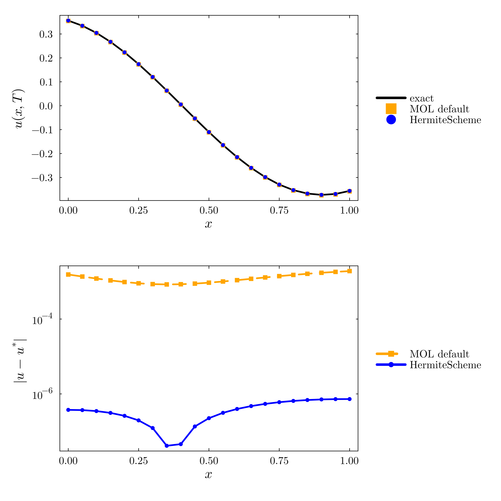
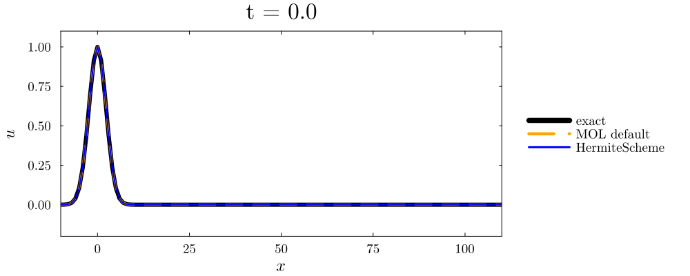
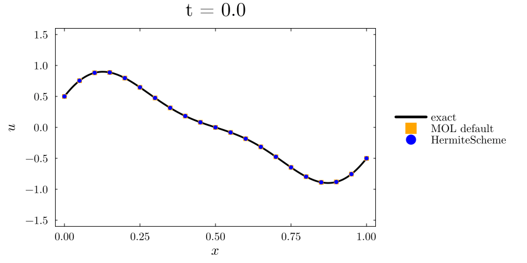
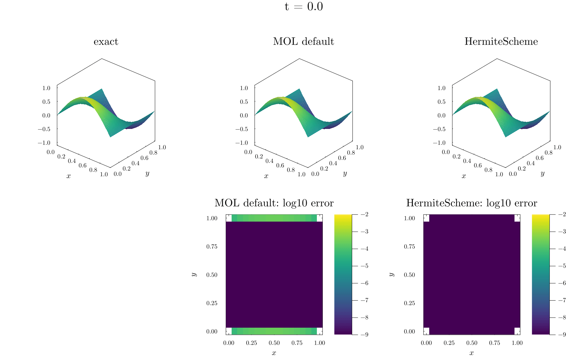
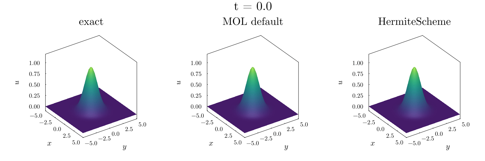
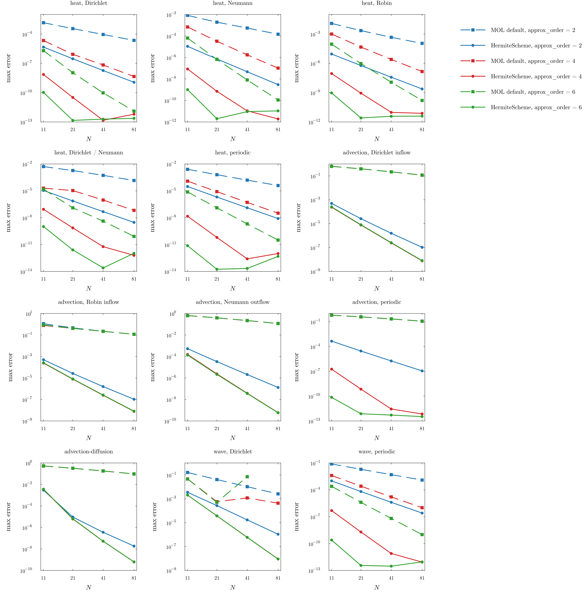
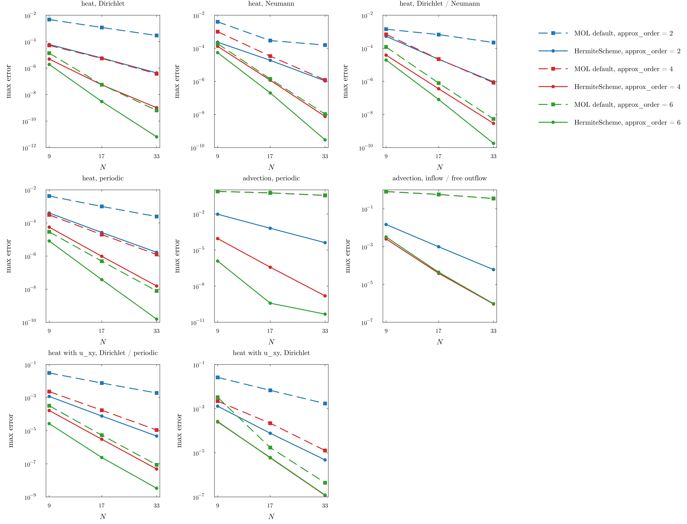

# [Hermite finite differences](@id hermite_scheme)

`HermiteScheme` approximates every spatial derivative of a variable ``u`` in a direction where
``u`` has a derivative partner from the values of ``u`` and of its first derivative at the
stencil points ([Fornberg 2021](@ref hermite_references)); other derivatives use central
differences:

```math
\frac{\partial^d u}{\partial x^d}(x_0) \approx \sum_i a_i\, u(x_i) + \sum_i b_i\, u_x(x_i).
```

With ``m`` points this has order ``2m - d``, about twice the order of the ordinary stencil on
the same points. The first derivative is carried as an extra unknown, the derivative
partner ``v = u_x`` (typically named `uˍx` in the code), with its own evolution equation.
`HermiteScheme()` adds the partners and their equations, initial and boundary conditions to
the system before it is discretized, so the PDE is written as usual.

The plots on this page use this style:

```julia
using Plots
plot_font = "Computer Modern"
default(fontfamily = plot_font, margin = 5Plots.mm, dpi = 300, linewidth = 3,
    framestyle = :box, label = nothing, color = "blue", grid = false,
    fg_legend = false, background_color_legend = false)
scalefontsizes(1.5)
```

## Quick start

The heat equation ``u_t = u_{xx}`` with Neumann conditions, solved with MOL's default scheme
and with `HermiteScheme()` on the same grid. Only `advection_scheme` changes.

```julia
using MethodOfLines, ModelingToolkit, DomainSets, OrdinaryDiffEq

@parameters t x
@variables u(..)
Dt, Dx = Differential(t), Differential(x)

T = 0.1
u_exact(x, t) = exp(-π^2 * t) * cos(π * x + 0.3)
u_exact_x(x, t) = -π * exp(-π^2 * t) * sin(π * x + 0.3)

eq = Dt(u(t, x)) ~ Dx(Dx(u(t, x)))
bcs = [u(0, x) ~ u_exact(x, 0),
    Dx(u(t, 0)) ~ u_exact_x(0, t), Dx(u(t, 1)) ~ u_exact_x(1, t)]
domains = [t ∈ Interval(0.0, T), x ∈ Interval(0.0, 1.0)]
@named heat = PDESystem(eq, bcs, domains, [t, x], [u(t, x)])

N = 21
mol = MOLFiniteDifference([x => 1 / (N - 1)], t)
hermite = MOLFiniteDifference([x => 1 / (N - 1)], t; advection_scheme = HermiteScheme())

sol_mol = solve(discretize(heat, mol); saveat = [T], abstol = 1e-12, reltol = 1e-12)
sol_her = solve(discretize(heat, hermite); saveat = [T], abstol = 1e-12, reltol = 1e-12)

err(sol) = maximum(abs, sol[u(t, x)][end, :] .- u_exact.(sol[x], T))
(MOL = err(sol_mol), Hermite = err(sol_her))   # (MOL = 1.9e-3, Hermite = 7.3e-7)
```

`discretize` returns a `DAEProblem` for `HermiteScheme()`: the boundary conditions of the
partner ``u_x`` are algebraic equations. The solutions and their pointwise errors:

```julia
xs = sol_her[x]
p1 = plot(xs, u_exact.(xs, T); color = :black, label = "exact", xlabel = "x",
    ylabel = "u(x, T)", legend = :outerright)
scatter!(p1, sol_mol[x], sol_mol[u(t, x)][end, :]; color = :orange, marker = :square, msw = 0,
    label = "MOL default")
scatter!(p1, xs, sol_her[u(t, x)][end, :]; color = :blue, marker = :circle, msw = 0,
    label = "HermiteScheme")
p2 = plot(xs, abs.(sol_mol[u(t, x)][end, :] .- u_exact.(xs, T)); yscale = :log10,
    color = :orange, linestyle = :dash, marker = :square, msw = 0, label = "MOL default",
    xlabel = "x", ylabel = "|u - u*|", legend = :outerright)
plot!(p2, xs, abs.(sol_her[u(t, x)][end, :] .- u_exact.(xs, T)); color = :blue,
    marker = :circle, msw = 0, label = "HermiteScheme")
plot(p1, p2; layout = (2, 1), size = (900, 900))
```



## Using HermiteScheme

### Derivative partners

`HermiteScheme()` transforms the PDE system before it is discretized. For each dependent
variable ``u`` and spatial variable ``x`` it adds a partner ``v = u_x`` (`uˍx` in the
transformed system) with

  - the evolution equation ``v_t = \partial_x R``, from ``u``'s equation ``u_t = R``;
  - the initial condition ``v(t_0, x) = \partial_x u(t_0, x)``;
  - boundary conditions derived from those of ``u`` (see below).

For the heat equation ``u_t = u_{xx}`` the partner equation is ``v_t = u_{xxx}``, and both
``u_{xx}`` and ``u_{xxx}`` are approximated from the values of ``u`` and ``v`` at the stencil
points. In ``n`` dimensions each variable gets one partner per direction, e.g. ``u_x`` and
``u_y`` in 2D. Each dependent variable needs exactly one equation that contains its first
time derivative ``u_t``, and ``u_t`` must appear linearly in it.

The names `uˍx` and `uˍt` (below) are the typical ones. If the system already has a variable or
parameter with that name, the generated variable gets a suffix, such as `uˍx_1`.

### Second time derivatives

An equation ``u_{tt} = R``, written with `Dt(Dt(u))`, is first rewritten as
``u_t = w,\; w_t = R`` (``w`` is named `uˍt`), and the partners are added to that system.
``R`` may contain ``u_t``, as in a damped wave ``u_{tt} = u_{xx} - 2u_t``. This
needs the initial condition ``u_t(t_0, x) = g(x)`` (`Dt(u(t0, x)) ~ g`) and Dirichlet, Neumann
or periodic conditions on ``u``. With Robin conditions, or conditions that contain time
derivatives, write the first-order system yourself.

### Boundary conditions

The partners' boundary conditions are derived from those of ``u``:

| condition on ``u`` at a boundary of ``x`` | condition on the partner ``v = u_x`` |
|:---|:---|
| Dirichlet ``u = g`` | a condition on ``v`` or ``v_x`` solved from ``u``'s equation on the boundary: ``v_x = g_t`` for ``u_t = u_{xx}``, ``v = -g_t`` for ``u_t = -u_x`` at ``x = 0`` |
| Neumann ``u_x = g`` | ``v = g``, which replaces the condition on ``u`` |
| Robin ``a u + b u_x = g`` | ``v = (g - a u)/b``, which replaces the condition on ``u`` |
| periodic | periodic |
| none (free outflow) | none |

At a Dirichlet wall where the advection velocity points out of the domain (``a > 0`` at
``x = 1`` for ``u_t = -a u_x + \dots``), the condition solved from ``u``'s equation would make
the system unstable on some grids. There the partner is instead a one-sided difference of ``u`` of order
6, or lower if the direction has fewer than 14 points, as MOL's upwind scheme does not use the
outflow value for advection. This needs a velocity that is a number at the wall.

Along a boundary, the partner of the tangential direction gets the tangential derivative of
the data, e.g. ``u_y = g_y`` on a boundary ``x = 0`` with ``u = g``. For a wave equation
written as a system, the Dirichlet condition uses the other equations as well, so data on
``u`` alone are enough.

### Mixed derivatives

In more than one dimension a mixed derivative is approximated from the partners,

```math
u_{xy} \approx \delta_y u_x + \delta_x u_y - \delta_x \delta_y u,
```

where ``\delta_x`` and ``\delta_y`` are difference operators in ``x`` and ``y``. Its order is
twice that of ``\delta_x \delta_y u``. On a Dirichlet wall ``x = 0``, the condition on ``u_x``
then contains its derivative along the wall, ``\partial_y u_x``, which uses MOL's centred
difference in ``y``.

### Explicit partners

A PDE that is already written in terms of its derivative partners can name them:

```julia
@parameters y
@variables v(..) vx(..) vy(..)
HermiteScheme(deriv_var = u => v)                         # one spatial dimension
HermiteScheme(deriv_var = [(u, x) => vx, (u, y) => vy])   # one partner per direction
```

The system is then not transformed: the partners' equations and their initial and boundary
conditions must be part of the `PDESystem`. For a variable of more than one spatial
dimension the mapping must name the direction; `u => vx` is rejected.

### Non-uniform grids

A grid given as a vector of points works with `HermiteScheme`: the weights are computed from
the actual coordinates. Periodic conditions and interfaces on a non-uniform grid are not
supported. On a non-uniform grid the interior is discretized point by point instead of as
array equations, so building the problem takes longer.

### Discretization and solvers

Away from the boundaries the derivatives use Hermite stencils on the points of MOL's
centred stencil for the chosen `approx_order`. Near a boundary the stencils are graded so
that the semi-discrete system is stable; the boundaries then set the global order.
Variables without a partner use MOL's stencils.

`discretize` returns a `DAEProblem`; on a uniform grid its interior equations are array
equations. Without an `initializealg`, the initialization uses
`BrownFullBasicInit(abstol = 1e-8)`: the partner equations carry one derivative order more
than the PDE, so a residual evaluation has more round-off than with MOL's default scheme.
To use an explicit Runge–Kutta method, compile the system to an ODE with
`symbolic_discretize` and `mtkcompile`, as in the 2D periodic example below. `mtkcompile`
scalarizes the system, so that path builds more slowly than `discretize`.

## How errors are measured

All errors on this page are measured against an exact solution ``u^*`` at the final time ``T``:

```math
E_N = \max_i \left| u_i(T) - u^*(x_i, T) \right|,
```

the maximum over the grid points ``x_i`` of a grid with ``N`` points per direction, including
the boundary points. The reported two-dimensional convergence errors exclude the four
corners. For `HermiteScheme`, corners and edges shared by Dirichlet faces take the prescribed
values where the boundary data can be evaluated (see [What values do the corners of my
domain take?](@ref)). The observed order between two grids is

```math
p = \frac{\log(E_{N_1} / E_{N_2})}{\log(h_1 / h_2)}, \qquad h = \frac{1}{N - 1}.
```

Both schemes use `discretize` and the default solver of `solve`, with
``\mathrm{abstol} = \mathrm{reltol} = 10^{-12}`` in 1D and ``10^{-10}`` in 2D, so the error
of the time integration is below the spatial error. Errors below about ``10^{-11}`` are
round-off.

## Examples

The examples compare the exact solution, MOL's default scheme and `HermiteScheme()` on the
same grid, as animations over time. They continue the quick start (the same `t`, `x`, `u`,
`Dt` and `Dx`). The surface and heatmap calls pass `color = :viridis`, because the
`color = "blue"` of the style above is a single colour, not a colour map.

### Advection of a Gaussian pulse

Fornberg's model problem ([Fornberg 2021](@ref hermite_references), eq. 3.2): ``u_t + u_x = 0`` with ``u(0, x) = e^{-(0.3x)^2}``,
whose solution is the translated pulse ``u^* = e^{-(0.3(x - t))^2}``. The grid spacing is
``h = 1``, so the pulse is resolved by only a few points, and it travels over 100 grid
spacings. Data from the exact solution are given at both ends of the domain.

```julia
h = 1.0
T = 100.0
xmin, xmax = -50.0, 50.0 + T
u_exact(x, t) = exp(-(0.3 * (x - t))^2)

eq = Dt(u(t, x)) ~ -Dx(u(t, x))
bcs = [u(0, x) ~ u_exact(x, 0.0), u(t, xmin) ~ u_exact(xmin, t), u(t, xmax) ~ u_exact(xmax, t)]
@named advection = PDESystem(eq, bcs, [t ∈ Interval(0.0, T), x ∈ Interval(xmin, xmax)],
    [t, x], [u(t, x)])

ts = range(0, T; length = 51)
sm = solve(discretize(advection, MOLFiniteDifference([x => h], t)); saveat = ts)
sh = solve(discretize(advection, MOLFiniteDifference([x => h], t;
    advection_scheme = HermiteScheme())); saveat = ts)
xs = sh[x]

err(s) = maximum(abs, s[u(t, x)][end, :] .- u_exact.(xs, T))
println("t = $T:  MOL default ", err(sm), "   HermiteScheme ", err(sh))

window = (-10.0, T + 10.0)         # a fixed window, so that the pulse travels across the axis
inside = findall(window[1] .<= xs .<= window[2])
anim = @animate for (k, tk) in enumerate(ts)
    plot(xs[inside], u_exact.(xs[inside], tk); color = :black, linewidth = 6, label = "exact",
        xlims = window, ylims = (-0.2, 1.1), xlabel = "x", ylabel = "u",
        title = "t = $(round(tk; digits = 1))", legend = :outerright, size = (1000, 400), dpi = 100)
    plot!(xs[inside], sm[u(t, x)][k, inside]; color = :orange, linestyle = :dash, label = "MOL default")
    plot!(xs[inside], sh[u(t, x)][k, inside]; color = :blue, linewidth = 2, label = "HermiteScheme")
end
gif(anim, "advection1d.gif"; fps = 10)
```



### Wave equation with fixed ends

``u_{tt} = u_{xx}``, written with `Dt(Dt(u))`: `HermiteScheme()` rewrites it as a first-order
system in time. Waves run both ways and reflect at the walls, where ``u`` is given.

```julia
T = 10.0
u_exact(x, t) = sin(2π * (x - t)) + 0.5 * cos(3π * (x + t))
u_exact_t(x, t) = -2π * cos(2π * (x - t)) - 1.5π * sin(3π * (x + t))
eq = Dt(Dt(u(t, x))) ~ Dx(Dx(u(t, x)))
bcs = [u(0, x) ~ u_exact(x, 0), Dt(u(0, x)) ~ u_exact_t(x, 0),
    u(t, 0) ~ u_exact(0, t), u(t, 1) ~ u_exact(1, t)]
@named wave = PDESystem(eq, bcs, [t ∈ Interval(0.0, T), x ∈ Interval(0.0, 1.0)],
    [t, x], [u(t, x)])

dxs = [x => 1 / 20]
ts = range(0, T; length = 101)
sm = solve(discretize(wave, MOLFiniteDifference(dxs, t)); saveat = ts, abstol = 1e-12, reltol = 1e-12)
sh = solve(discretize(wave, MOLFiniteDifference(dxs, t; advection_scheme = HermiteScheme()));
    saveat = ts, abstol = 1e-12, reltol = 1e-12)
xs, xf = sh[x], range(0, 1; length = 200)
err(s) = maximum(abs, s[u(t, x)][end, :] .- u_exact.(xs, T))
println("t = $T:  MOL default ", err(sm), "   HermiteScheme ", err(sh))

anim = @animate for (k, tk) in enumerate(ts)
    plot(xf, u_exact.(xf, tk); color = :black, label = "exact", ylims = (-1.6, 1.6),
        xlabel = "x", ylabel = "u", title = "t = $(round(tk; digits = 1))",
        legend = :outerright, size = (900, 450), dpi = 100)
    scatter!(xs, sm[u(t, x)][k, :]; color = :orange, marker = :square, msw = 0, label = "MOL default")
    scatter!(xs, sh[u(t, x)][k, :]; color = :blue, marker = :circle, msw = 0, label = "HermiteScheme")
end
gif(anim, "wave_dirichlet.gif"; fps = 12)
```



### Heat equation in 2D, mixed conditions

``u_t = 0.1\,(u_{xx} + u_{yy})`` with ``u = 0`` at ``x = 0, 1`` and ``u_y = 0`` at
``y = 0, 1``. In 2D each variable gets a partner per direction, ``u_x`` and ``u_y``. The top
row shows the solutions, the bottom row the base-10 logarithm of the pointwise error of each
scheme on the same colour scale; the four corner points are left out of the errors, as in the
convergence study below. The dark lines are where the error is below the colour scale: the
walls ``x = 0, 1``, where the data are imposed, and the line ``y = 1/2``, where this solution
vanishes by symmetry.

```julia
@parameters y
Dy = Differential(y)
T = 0.5
u_exact2(x, y, t) = exp(-0.2π^2 * t) * sin(π * x) * cos(π * y)
eq = Dt(u(t, x, y)) ~ 0.1 * (Dx(Dx(u(t, x, y))) + Dy(Dy(u(t, x, y))))
bcs = [u(0, x, y) ~ u_exact2(x, y, 0),
    u(t, 0, y) ~ 0, u(t, 1, y) ~ 0, Dy(u(t, x, 0)) ~ 0, Dy(u(t, x, 1)) ~ 0]
domains = [t ∈ Interval(0.0, T), x ∈ Interval(0.0, 1.0), y ∈ Interval(0.0, 1.0)]
@named heat2d = PDESystem(eq, bcs, domains, [t, x, y], [u(t, x, y)])

dxs = [x => 1 / 16, y => 1 / 16]
ts = range(0, T; length = 16)
sm = solve(discretize(heat2d, MOLFiniteDifference(dxs, t)); saveat = ts, abstol = 1e-10, reltol = 1e-10)
sh = solve(discretize(heat2d, MOLFiniteDifference(dxs, t; advection_scheme = HermiteScheme()));
    saveat = ts, abstol = 1e-10, reltol = 1e-10)
xs, ys = sh[x], sh[y]
exact(k) = [u_exact2(xi, yj, ts[k]) for yj in ys, xi in xs]
field(s, k) = s[u(t, x, y)][k, :, :]'
function logerror(s, k)
    e = log10.(max.(abs.(field(s, k) .- exact(k)), 1e-16))
    e[[1, end], [1, end]] .= NaN
    return e
end
anim = @animate for k in eachindex(ts)
    surf = (zlims = (-1.1, 1.1), clims = (-1, 1), camera = (40, 30), colorbar = false,
        color = :viridis, xlabel = "x", ylabel = "y")
    errs = (clims = (-9, -2), color = :viridis, xlabel = "x", ylabel = "y")
    plot(surface(xs, ys, exact(k); title = "exact", surf...),
        surface(xs, ys, field(sm, k); title = "MOL default", surf...),
        surface(xs, ys, field(sh, k); title = "HermiteScheme", surf...),
        plot(; framestyle = :none),
        heatmap(xs, ys, logerror(sm, k); title = "MOL default: log10 error", errs...),
        heatmap(xs, ys, logerror(sh, k); title = "HermiteScheme: log10 error", errs...);
        layout = (2, 3), size = (1800, 1100), plot_title = "t = $(round(ts[k]; digits = 2))",
        plot_titlevspan = 0.1, dpi = 100)
end
gif(anim, "heat2d.gif"; fps = 4)
```



### Advection in 2D, periodic

The convection example of the MOL FAQ with only the scheme changed: ``u_t = u_x + u_y`` on
``[-5, 5]^2``, periodic in both directions, with a Gaussian initial condition
``u(0, x, y) = e^{-(x^2 + y^2)/2}``. The exact solution is the initial condition translated
by ``(t, t)``, wrapped around the domain. The grid spacing is ``0.25`` in both directions.
This example uses an explicit Runge–Kutta method on the compiled ODE system, so it goes
through `symbolic_discretize` and `mtkcompile` instead of `discretize`.

```julia
@parameters y
Dy = Differential(y)
t_max = 7.0
x_min, x_max = -5.0, 5.0
y_min, y_max = -5.0, 5.0
ic(x, y) = exp(-(x^2 + y^2) / 2)

eq = Dt(u(t, x, y)) - Dx(u(t, x, y)) - Dy(u(t, x, y)) ~ 0
bcs = [u(0, x, y) ~ ic(x, y),
    u(t, x_min, y) ~ u(t, x_max, y),
    u(t, x, y_min) ~ u(t, x, y_max)]
domains = [t ∈ Interval(0.0, t_max), x ∈ Interval(x_min, x_max), y ∈ Interval(y_min, y_max)]
@named convection = PDESystem([eq], bcs, domains, [t, x, y], [u(t, x, y)])

function solve_with(scheme)
    dxs = [x => 0.25, y => 0.25]
    disc = scheme === nothing ? MOLFiniteDifference(dxs, t) :
        MOLFiniteDifference(dxs, t; advection_scheme = scheme)
    sys, tspan = symbolic_discretize(convection, disc)
    prob = ODEProblem(mtkcompile(sys), nothing, tspan)
    return solve(prob, Tsit5(); saveat = 0.5)
end
sol_mol = solve_with(nothing)
sol_her = solve_with(HermiteScheme())

xs, ys, ts = sol_her[x], sol_her[y], sol_her[t]
wrap(z, lo, hi) = mod(z - lo, hi - lo) + lo
exact(tk) = [ic(wrap(xi + tk, x_min, x_max), wrap(yj + tk, y_min, y_max)) for yj in ys, xi in xs]
field(sol, k) = Array(sol[u(t, x, y)][k, :, :])'
err(sol) = maximum(abs, field(sol, length(ts)) .- exact(t_max))
println("t = $t_max:  MOL default ", err(sol_mol), "   HermiteScheme ", err(sol_her))

anim = @animate for k in eachindex(ts)
    opts = (camera = (55, 30), zlims = (-0.1, 1.2), clims = (0, 1), colorbar = false,
        color = :viridis, xlabel = "x", ylabel = "y", zlabel = "u")
    plot(surface(xs, ys, exact(ts[k]); title = "exact", opts...),
        surface(xs, ys, field(sol_mol, k); title = "MOL default", opts...),
        surface(xs, ys, field(sol_her, k); title = "HermiteScheme", opts...);
        layout = (1, 3), size = (1500, 500), plot_title = "t = $(round(ts[k]; digits = 2))",
        plot_titlevspan = 0.1, dpi = 100)
end
gif(anim, "convection2d.gif"; fps = 5)
```



## Convergence

Each problem below has an exact solution ``u^*`` that gives its initial and boundary data. It
is solved for ``0 \le t \le T`` with MOL's default scheme and with `HermiteScheme()` at
`approx_order = 2`, `4` and `6`, on the grids listed; errors are measured as described in
[How errors are measured](@ref).

Each figure shows the maximum error at ``t = T`` against the number of grid points ``N`` per
direction, with one panel per row of the table above it, in the same order (left to right,
then top to bottom); the panel titles are those in the table's first column. Dashed lines
with squares: MOL's default scheme; solid lines with circles: `HermiteScheme()`; colour:
`approx_order`. For advection, MOL's default
scheme is first-order upwind at every `approx_order`, so its three lines coincide. Unstable
runs are left out (MOL's default scheme for the wave equation with Dirichlet walls at
`approx_order = 6`). The flat parts of the Hermite curves near ``10^{-12}`` are round-off.

### One dimension

On ``0 \le x \le 1``:

| panel | PDE | initial condition | boundary conditions | exact solution | final time | grid points per direction |
|:---|:---|:---|:---|:---|---:|:---|
| heat, Dirichlet | ``u_t = u_{xx}`` | ``u(0,x) = u^*(x,0)`` | ``u(t,0) = u^*(0,t),\; u(t,1) = u^*(1,t)`` | ``u^* = e^{-\pi^2 t}\cos(\pi x + 0.3)`` | ``T = 0.1`` | 11, 21, 41, 81 |
| heat, Neumann | ``u_t = u_{xx}`` | ``u(0,x) = u^*(x,0)`` | ``u_x(t,0) = u^*_x(0,t),\; u_x(t,1) = u^*_x(1,t)`` | ``u^* = e^{-\pi^2 t}\cos(\pi x + 0.3)`` | ``T = 0.1`` | 11, 21, 41, 81 |
| heat, Robin | ``u_t = u_{xx}`` | ``u(0,x) = u^*(x,0)`` | ``(u + u_x)(t,0) = (u^* + u^*_x)(0,t),\; (u + u_x)(t,1) = (u^* + u^*_x)(1,t)`` | ``u^* = e^{-\pi^2 t}\cos(\pi x + 0.3)`` | ``T = 0.1`` | 11, 21, 41, 81 |
| heat, Dirichlet / Neumann | ``u_t = u_{xx}`` | ``u(0,x) = u^*(x,0)`` | ``u(t,0) = u^*(0,t),\; u_x(t,1) = u^*_x(1,t)`` | ``u^* = e^{-\pi^2 t}\cos(\pi x + 0.3)`` | ``T = 0.1`` | 11, 21, 41, 81 |
| heat, periodic | ``u_t = u_{xx}`` | ``u(0,x) = u^*(x,0)`` | ``u(t,0) = u(t,1)`` | ``u^* = e^{-4\pi^2 t}\sin(2\pi x)`` | ``T = 0.1`` | 11, 21, 41, 81 |
| advection, Dirichlet inflow | ``u_t = -u_x`` | ``u(0,x) = u^*(x,0)`` | ``u(t,0) = u^*(0,t)\text{; none at } x = 1`` | ``u^* = \sin(2\pi(x - t))`` | ``T = 0.5`` | 11, 21, 41, 81 |
| advection, Robin inflow | ``u_t = -u_x`` | ``u(0,x) = u^*(x,0)`` | ``(u + u_x)(t,0) = (u^* + u^*_x)(0,t)\text{; none at } x = 1`` | ``u^* = \sin(2\pi(x - t))`` | ``T = 0.5`` | 11, 21, 41, 81 |
| advection, Neumann outflow | ``u_t = -u_x`` | ``u(0,x) = u^*(x,0)`` | ``u(t,0) = u^*(0,t),\; u_x(t,1) = u^*_x(1,t)`` | ``u^* = \sin(2\pi(x - t))`` | ``T = 0.5`` | 11, 21, 41, 81 |
| advection, periodic | ``u_t = -u_x`` | ``u(0,x) = u^*(x,0)`` | ``u(t,0) = u(t,1)`` | ``u^* = \sin(2\pi(x - t))`` | ``T = 0.5`` | 11, 21, 41, 81 |
| advection-diffusion | ``u_t = -u_x + 0.01\,u_{xx}`` | ``u(0,x) = u^*(x,0)`` | ``u(t,0) = u^*(0,t),\; u(t,1) = u^*(1,t)`` | ``u^* = e^{-0.04\pi^2 t}\sin(2\pi(x - t))`` | ``T = 0.5`` | 11, 21, 41, 81 |
| wave, Dirichlet | ``u_{tt} = u_{xx}`` | ``u(0,x) = u^*(x,0),\; u_t(0,x) = u^*_t(x,0)`` | ``u(t,0) = u^*(0,t),\; u(t,1) = u^*(1,t)`` | ``u^* = \sin(2\pi(x - t)) + 0.5\cos(3\pi(x + t))`` | ``T = 0.75`` | 11, 21, 41, 81 |
| wave, periodic | ``u_{tt} = u_{xx}`` | ``u(0,x) = u^*(x,0),\; u_t(0,x) = u^*_t(x,0)`` | ``u(t,0) = u(t,1)`` | ``u^* = \sin(2\pi(x - t))`` | ``T = 0.75`` | 11, 21, 41, 81 |



For the advection-diffusion problem ``u_t = -u_x + \varepsilon u_{xx}`` with Dirichlet data
at both ends, `HermiteScheme` is stable on every grid from 11 to 41 points, for
``\varepsilon = 0.1, 0.01, 0.001`` and `approx_order` 2, 4 and 6. On grids with fewer than 14
points the outflow stencil has order 4, which is why the three Hermite curves meet at
``N = 11``.

### Two dimensions

On ``0 \le x, y \le 1``:

| panel | PDE | initial condition | boundary conditions | exact solution | final time | grid points per direction |
|:---|:---|:---|:---|:---|---:|:---|
| heat, Dirichlet | ``u_t = 0.1\,(u_{xx} + u_{yy})`` | ``u(0,x,y) = u^*(x,y,0)`` | ``u = 0 \text{ on all four sides}`` | ``u^* = e^{-0.2\pi^2 t}\sin(\pi x)\sin(\pi y)`` | ``T = 0.5`` | 9, 17, 33 |
| heat, Neumann | ``u_t = 0.1\,(u_{xx} + u_{yy})`` | ``u(0,x,y) = u^*(x,y,0)`` | ``u_x(t,0,y) = u_x(t,1,y) = 0,\; u_y(t,x,0) = u_y(t,x,1) = 0`` | ``u^* = e^{-0.2\pi^2 t}\cos(\pi x)\cos(\pi y)`` | ``T = 0.5`` | 9, 17, 33 |
| heat, Dirichlet / Neumann | ``u_t = 0.1\,(u_{xx} + u_{yy})`` | ``u(0,x,y) = u^*(x,y,0)`` | ``u(t,0,y) = u(t,1,y) = 0,\; u_y(t,x,0) = u_y(t,x,1) = 0`` | ``u^* = e^{-0.2\pi^2 t}\sin(\pi x)\cos(\pi y)`` | ``T = 0.5`` | 9, 17, 33 |
| heat, periodic | ``u_t = 0.1\,(u_{xx} + u_{yy})`` | ``u(0,x,y) = u^*(x,y,0)`` | ``u(t,0,y) = u(t,1,y),\; u(t,x,0) = u(t,x,1)`` | ``u^* = e^{-0.8\pi^2 t}\sin(2\pi x)\sin(2\pi y)`` | ``T = 0.5`` | 9, 17, 33 |
| advection, periodic | ``u_t = -0.8\,u_x - 0.6\,u_y`` | ``u(0,x,y) = u^*(x,y,0)`` | ``u(t,0,y) = u(t,1,y),\; u(t,x,0) = u(t,x,1)`` | ``u^* = \sin(2\pi(x - 0.8t))\sin(2\pi(y - 0.6t))`` | ``T = 0.5`` | 9, 17, 33 |
| advection, inflow / free outflow | ``u_t = -0.8\,u_x - 0.6\,u_y`` | ``u(0,x,y) = u^*(x,y,0)`` | ``u(t,0,y) = u^*(0,y,t),\; u(t,x,0) = u^*(x,0,t)\text{; none at } x = 1,\ y = 1`` | ``u^* = \sin(2\pi(x - 0.8t))\sin(2\pi(y - 0.6t))`` | ``T = 0.5`` | 9, 17, 33 |
| heat with ``u_{xy}``, Dirichlet / periodic | ``u_t = 0.1\,(u_{xx} + u_{yy} + u_{xy}) + f`` | ``u(0,x,y) = u^*(x,y,0)`` | ``u(t,0,y) = u^*(0,y,t),\; u(t,1,y) = u^*(1,y,t),\; u(t,x,0) = u(t,x,1)`` | ``u^* = e^{-t}\sin(\pi x + 0.5)\,(2 + \cos(2\pi y))`` | ``T = 0.5`` | 9, 17, 33 |
| heat with ``u_{xy}``, Dirichlet | ``u_t = 0.1\,(u_{xx} + u_{yy} + u_{xy}) + f`` | ``u(0,x,y) = u^*(x,y,0)`` | ``u = u^* \text{ on all four sides}`` | ``u^* = e^{-t}\sin(\pi x + 0.5)\,(2 + \cos(2\pi y))`` | ``T = 0.5`` | 9, 17, 33 |

In the two ``u_{xy}`` cases the source ``f`` is chosen so that ``u^*`` is the exact solution.



## Limitations

These throw an `ArgumentError`:

  - periodic conditions or interfaces on a non-uniform grid;
  - interfaces between two different variables;
  - a variable without exactly one equation containing ``u_t``, or an equation in which
    ``u_t`` does not appear linearly;
  - time derivatives of third or higher order, and `Dt(Dt(u))` with Robin conditions or
    conditions containing time derivatives (write these as a first-order system);
  - with `HermiteScheme()`, Dirichlet data that contain a dependent variable, such as
    `u(t, 0) ~ w(t, 0)`;
  - an automatic `HermiteScheme()` with `should_transform = false`;
  - an automatic `HermiteScheme()` for a system without a time variable;
  - an automatic `HermiteScheme()` for a PDE with a spatial derivative of a dependent
    variable of fourth or higher order after symbolic expansion, such as
    `Dx((1 + x) * Dx(Dx(Dx(u))))`;
  - an automatic `HermiteScheme()` for a PDE with a third spatial derivative of a variable in
    a direction in which that variable is not periodic, such as `Dt(u) ~ -Dx(Dx(Dx(u)))` with
    walls in `x`: the Hermite closure of a third derivative at a wall is unstable. This
    applies to the PDE as written, not to the partners' equations such as ``v_t = u_{xxx}``;
  - Dirichlet conditions that are not linear in ``u``, such as `u(t, 0)^2 ~ 1`;
  - a Dirichlet wall of ``u`` whose evolution equation has a second or higher derivative of
    another variable that is periodic in that direction;
  - an explicit mapping without a direction (`u => vx`) for a variable of more than one
    spatial dimension;
  - an explicit mapping whose variable or partner is not a dependent variable of the PDE
    system, that gives one derivative two partners, or that maps a variable to itself;
  - a `StaggeredGrid` or an `EdgeAlignedGrid`.

A boundary without a condition (the free outflow of an advection equation) has a lower order
than the interior. In the convergence study above this limits the observed order to about 5
at `approx_order = 6`.

At a Dirichlet wall where the advection velocity depends on ``t`` or on a parameter, the
partner keeps the condition solved from ``u``'s equation, which can make the system unstable
on some grids.

`HermiteScheme` applies no upwinding. It is meant for smooth solutions; for steep fronts and
discontinuities use an upwind or WENO scheme (see [advection schemes](@ref adschemes)).

## [References](@id hermite_references)

  - B. Fornberg, *An algorithm for calculating Hermite-based finite difference weights*, IMA Journal of Numerical Analysis 41 (2021), 801–813, [doi:10.1093/imanum/draa006](https://doi.org/10.1093/imanum/draa006).
